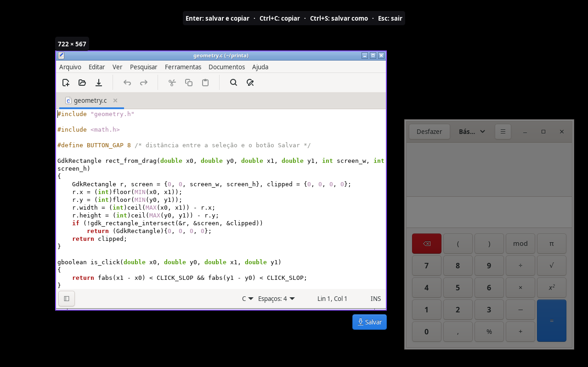

<p align="center">
  
</p>

<h1 align="center">printa</h1>

<p align="center">
  Captura de tela leve para Linux (X11), escrita em C com GTK3 — no espírito do Flameshot.
</p>

<p align="center">
  
  
  
</p>

---

<p align="center">
  
</p>

## Recursos

- **Janela com um clique** — passe o mouse e a janela sob o cursor é destacada; clique para selecioná-la (com a moldura, sem a sombra invisível das janelas GTK).
- **Região livre** — arraste para selecionar qualquer retângulo, em qualquer direção.
- **Tela congelada** — a imagem é tirada antes de a interface aparecer, então menus e tooltips abertos entram na captura (combine com `-d`).
- **Salvar ou copiar** — salva em `~/Imagens`, copia para a área de transferência, ou os dois; "Salvar como" aceita PNG e JPEG.
- **Vários monitores e HiDPI** — cobre a área de trabalho inteira e salva na resolução real da tela.
- **Pequeno** — um binário, sem serviço em segundo plano, sem configuração.

## Instalação

Dependências de compilação:

| Distribuição | Comando |
| --- | --- |
| Debian / Ubuntu / Mint | `sudo apt install build-essential libgtk-3-dev` |
| Fedora | `sudo dnf install gcc make gtk3-devel libX11-devel` |
| Arch | `sudo pacman -S base-devel gtk3 libx11` |

Compile e instale (em `/usr/local/bin`, mude com `PREFIX=`):

```bash
git clone https://github.com/berdfandrade/printa.git
cd printa
make
sudo make install
```

Para remover: `sudo make uninstall`.

## Uso

```bash
printa          # captura agora
printa -d 3     # espera 3 segundos antes de capturar
```

A tela congela e escurece. Depois:

| Ação | Resultado |
| --- | --- |
| Passar o mouse | Destaca a janela sob o cursor (borda tracejada) |
| Clique | Seleciona essa janela |
| Arrastar | Seleciona uma região |
| **Enter** ou botão **Salvar** | Salva em `~/Imagens/Captura_<data>.png` e copia |
| Duplo clique numa janela | Seleciona e salva de uma vez |
| **Ctrl+C** | Só copia para a área de transferência |
| **Ctrl+S** | Abre "Salvar como" (`.png` ou `.jpg`) |
| **Esc** ou botão direito | Cancela |

Sem nenhuma seleção, **Enter** captura a tela inteira.

### Em scripts

O caminho do arquivo salvo vai para o stdout, e o código de saída é `0` quando
algo foi salvo ou copiado e `1` quando a captura foi cancelada ou falhou:

```bash
arquivo=$(printa) && notify-send "Captura salva" "$arquivo"
```

### Na tecla Print Screen

Crie um atalho de teclado personalizado que rode `printa`:

- **Cinnamon:** Configurações do Sistema → Teclado → Atalhos → *Adicionar atalho personalizado*.
- **GNOME (sessão Xorg):** Configurações → Teclado → Atalhos de teclado → *Atalhos personalizados*.
- **Outros ambientes:** qualquer ferramenta de atalhos globais, como `xbindkeys` ou `sxhkd`.

Se o ambiente já usar Print Screen para a própria captura, desative esse atalho antes.

## Como funciona

1. Ao iniciar, o printa lê a janela raiz do X11 inteira para um `GdkPixbuf` e
   pega a lista de janelas visíveis na ordem de empilhamento do gerenciador de
   janelas (`_NET_CLIENT_LIST_STACKING`), descontando a sombra das janelas CSD
   (`_GTK_FRAME_EXTENTS`).
2. Mostra uma janela sem bordas do tamanho de todos os monitores, desenhando a
   captura congelada com uma camada escura por cima, e prende mouse e teclado
   para si.
3. A seleção recorta o pixbuf original, então o resultado é exatamente o que
   estava na tela, sem a interface do printa.

### Estrutura

| Arquivo | Papel |
| --- | --- |
| `printa.c` | Captura, interface GTK, eventos, salvar e copiar |
| `geometry.c` | Geometria da seleção: arrasto, janela sob o cursor, sombra CSD, posição do botão |
| `output.c` | Recorte da captura, formato pela extensão, nome do arquivo |
| `tests/test_printa.c` | Testes de unidade de `geometry.c` e `output.c` |

## Testes

Os testes usam o GTest da GLib e não precisam de display:

```bash
make test
```

## Limitações

- **Só X11.** No Wayland o compositor não deixa programas lerem a tela
  diretamente; lá a captura sai em branco (o printa avisa).
- **Sem anotações.** Não há setas, texto nem desfoque como no Flameshot: o foco
  é capturar rápido.
- **Área de transferência.** A imagem copiada continua disponível depois que o
  printa fecha só se houver um gerenciador de área de transferência rodando (o
  Cinnamon e o GNOME têm um).

## Licença

[MIT](LICENSE) © 2026 Bernardo Andrade
